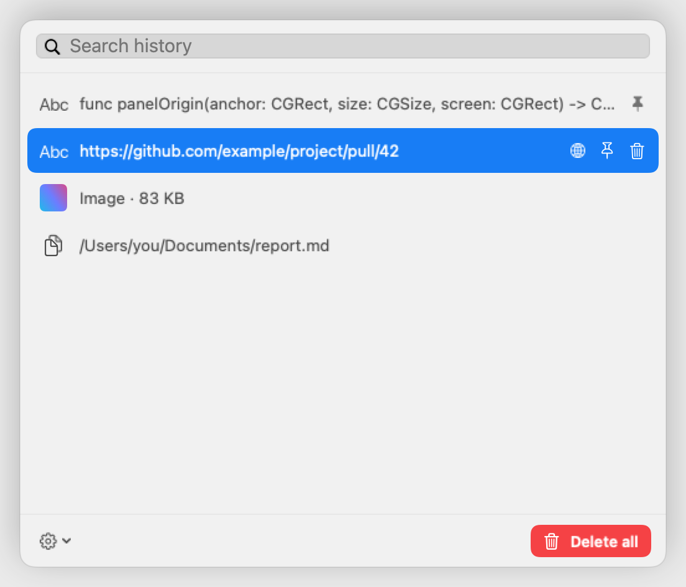
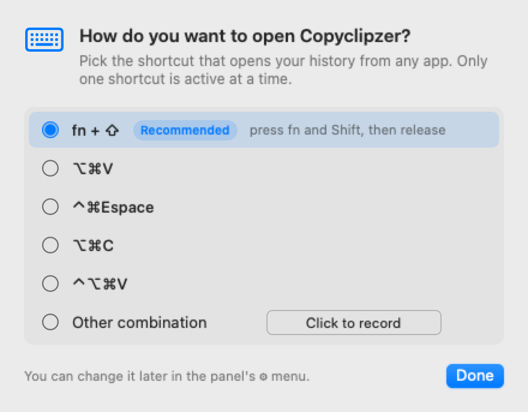
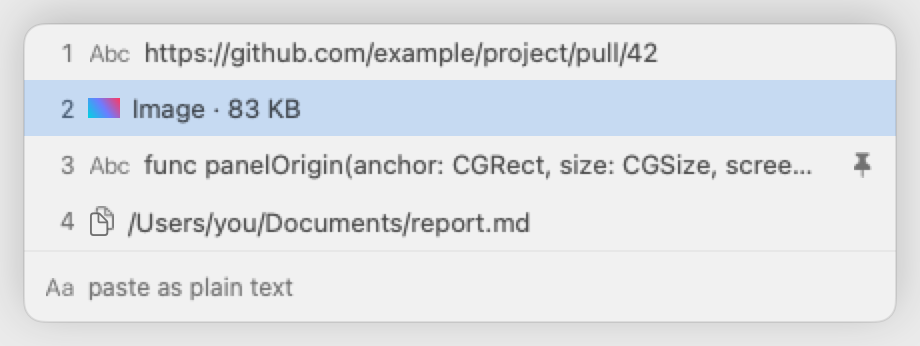

<h1 align="center">Copyclipzer</h1>

<p align="center"><b>L'historique de votre presse-papiers, sur votre Mac et nulle part ailleurs.</b></p>

<p align="center">
  <a href="https://github.com/charlesDabard/copyclipzer/releases/latest"></a>
  
  <a href="https://github.com/charlesDabard/copyclipzer/actions/workflows/ci.yml"></a>
  <a href="LICENSE"></a>
</p>

<p align="center"><a href="README.md">Read in English</a></p>

https://github.com/user-attachments/assets/de1e053d-9232-4e11-8656-50ec4cc9beb6

Un gestionnaire de presse-papiers lit tout ce que vous copiez : mots de passe, jetons, messages privés. Il doit garder cet historique sur votre machine et ne le confier à personne. Copyclipzer est construit sur cette règle. Pas de compte, pas de cloud, pas de télémétrie. Le code est ouvert : la règle se vérifie.

## Local, privé, rapide

- **Local.** L'historique tient dans un fichier SQLite sur votre Mac. Rien n'est synchronisé ni envoyé.
- **Privé.** Un contenu que les applications marquent comme confidentiel n'est jamais enregistré : gestionnaires de mots de passe, données temporaires ou générées. Toute application peut être exclue.
- **Rapide.** Pensé pour le clavier. L'historique est à un raccourci, depuis n'importe quelle application.

<p align="center">
  <picture>
    <source media="(prefers-color-scheme: dark)" srcset="screenshots/readme-search-dark.png">
    
  </picture>
</p>

## Utilisation

Au premier lancement, vous choisissez le raccourci qui ouvre le panneau. **fn + ⇧** est recommandé : il ne prend aucune combinaison à vos applications.

<p align="center">
  <picture>
    <source media="(prefers-color-scheme: dark)" srcset="screenshots/readme-shortcut-dark.png">
    
  </picture>
</p>

**Le panneau de recherche** filtre à la frappe.

| Touche                    | Action                  |
| ------------------------- | ----------------------- |
| <kbd>↑</kbd> <kbd>↓</kbd> | Parcourir les résultats |
| <kbd>↩</kbd>              | Coller                  |
| <kbd>⌥</kbd> <kbd>↩</kbd> | Coller en texte brut    |
| <kbd>esc</kbd>            | Fermer                  |

**Le geste Cmd** colle sans rien ouvrir. Maintenez <kbd>⌘</kbd>, appuyez sur <kbd>V</kbd> pour parcourir les dernières entrées, relâchez <kbd>⌘</kbd> pour coller.

<p align="center">
  <picture>
    <source media="(prefers-color-scheme: dark)" srcset="screenshots/readme-gesture-dark.png">
    
  </picture>
</p>

| <kbd>⌘</kbd> maintenu                  | Action                                            |
| -------------------------------------- | ------------------------------------------------- |
| <kbd>V</kbd> <kbd>V</kbd> <kbd>V</kbd> | Entrée suivante, retour en tête après la dernière |
| <kbd>1</kbd> à <kbd>9</kbd>            | Aller à une entrée                                |
| <kbd>Z</kbd>                           | Basculer en texte brut                            |
| <kbd>X</kbd>                           | Épingler ou désépingler                           |
| <kbd>esc</kbd>                         | Annuler                                           |

**Les images se retrouvent par leur texte.** Copiez la capture d'une erreur, d'une facture, d'une diapositive ou d'une conversation : Copyclipzer lit le texte qu'elle contient dès la copie, et un mot de l'image suffit à la retrouver. La reconnaissance tourne sur votre Mac avec Apple Vision, hors ligne, en français et en anglais. Les images déjà présentes dans l'historique sont traitées en arrière-plan au démarrage.

## Fonctionnalités

- **Tout ce que vous copiez :** texte, texte riche, fichiers et images.
- **Reconnaissance du texte des images :** captures, scans et photos de texte deviennent cherchables, hors ligne.
- **Épinglez** l'essentiel, il reste en tête.
- **Actions intelligentes :** ouvrir un lien, copier une couleur, écrire à une adresse e-mail.
- **Aperçu** de l'entrée sélectionnée.
- **Rétention réglable :** taille de l'historique, âge maximal, applications exclues, ouverture au démarrage.
- **Mises à jour automatiques,** vérifiées avant d'être installées.
- **Français et anglais.**

## Confidentialité et sécurité

Ce que fait Copyclipzer, dit exactement :

| Sujet | Ce qui se passe |
| -------------------- | ----------------------------------------------------------------------------------------------------------------------------------------------------------------------------------------------------------------- |
| **Stockage**         | `~/Library/Application Support/Copyclipzer/history.sqlite`, sur votre Mac uniquement. L'application ne le chiffre pas : il est protégé par votre session macOS et par FileVault, que nous recommandons d'activer. |
| **Réseau**           | Une seule requête : la vérification des mises à jour auprès de GitHub, toutes les 6 heures. Aucun profil système, aucune mesure d'audience. Désactivable dans ⚙︎ › Mises à jour.                                   |
| **Reconnaissance du texte** | Faite sur votre Mac par Apple Vision, hors ligne. Aucune image ne quitte votre Mac, et le texte reconnu reste dans l'historique local. |
| **Mises à jour**     | Chaque archive est signée par une clé EdDSA. Copyclipzer vérifie la signature avant d'installer, et refuse tout le reste.                                                                                         |
| **Contenus ignorés** | Tout ce qui est marqué `org.nspasteboard.ConcealedType`, `TransientType` ou `AutoGeneratedType`, et toute application exclue.                                                                                     |
| **Journal**          | `~/Library/Logs/Copyclipzer/` trace ce que fait l'application, jamais ce que vous avez copié. Un test lit chaque appel au journal dans les sources et échoue si l'un d'eux peut contenir un contenu copié.                                                   |
| **Autorisations**    | Accessibilité, pour le geste Cmd, le raccourci global et le collage dans l'application active. Le panneau de recherche fonctionne sans.                                                                           |

## Installation

**Téléchargement.** Prenez `Copyclipzer-x.y.z.zip` dans la [dernière version](https://github.com/charlesDabard/copyclipzer/releases/latest), décompressez, et placez `Copyclipzer.app` dans `/Applications`. L'application n'est pas notarisée par Apple : la première fois, clic droit puis **Ouvrir**. Ensuite, les mises à jour s'installent seules.

**Depuis les sources.** Il faut les Command Line Tools de Xcode.

```bash
git clone https://github.com/charlesDabard/copyclipzer.git
cd copyclipzer
./install.sh
```

Copyclipzer vit dans la barre des menus. Il n'a pas d'icône dans le Dock.

> [!NOTE]
> Au premier lancement, macOS demande l'autorisation Accessibilité. Accordez-la dans Réglages Système › Confidentialité et sécurité › Accessibilité.

## Développement

```bash
swift build
swift run CopyclipzerTests
```

Les tests couvrent les règles de capture, le stockage, la machine à états du clavier et les règles du raccourci. Chaque garantie a un test qui accepte le bon cas et un test qui refuse le mauvais. La publication d'une version est décrite dans [DISTRIBUTION.md](DISTRIBUTION.md).

## Licence

[MIT](LICENSE). Mises à jour assurées par [Sparkle](https://sparkle-project.org).
