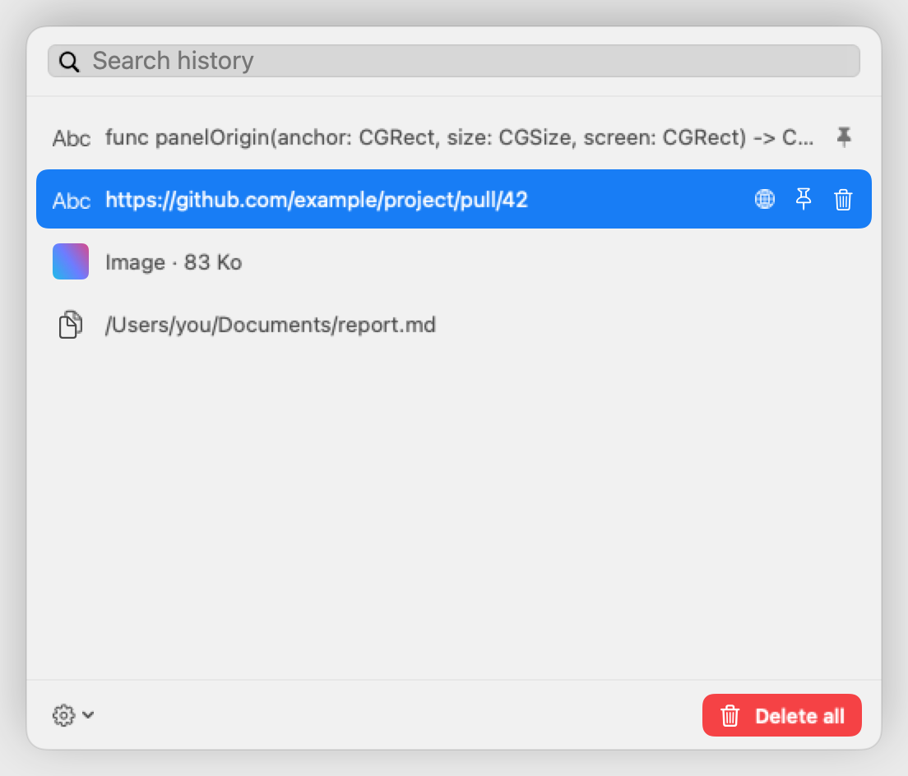
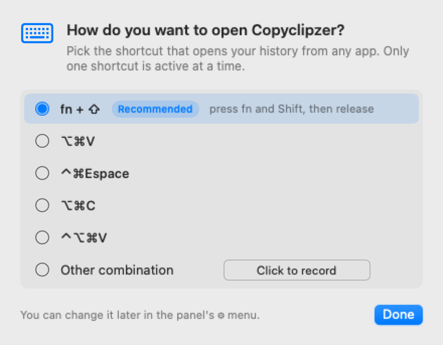
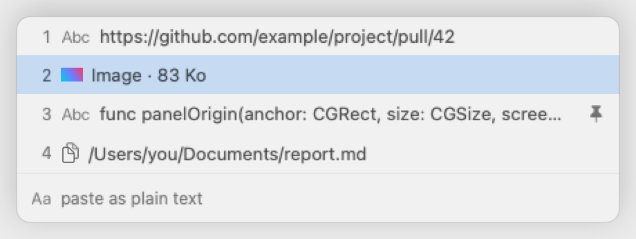

<p align="center">
  <picture>
    <source media="(prefers-color-scheme: dark)" srcset="screenshots/readme-search-dark.png">
    
  </picture>
</p>

<h1 align="center">Copyclipzer</h1>

<p align="center"><b>Your clipboard history, on your Mac and nowhere else.</b></p>

<p align="center">
  <a href="https://github.com/charlesDabard/copyclipzer/releases/latest"></a>
  
  <a href="https://github.com/charlesDabard/copyclipzer/actions/workflows/ci.yml"></a>
  <a href="LICENSE"></a>
</p>

<p align="center"><a href="README.fr.md">Lire en français</a></p>

A clipboard manager reads everything you copy: passwords, tokens, private messages. It should keep that history on your machine and tell no one. Copyclipzer is built on that rule. No account, no cloud, no telemetry. The code is open, so the rule can be checked.

## Local, private, fast

- **Local.** The history lives in one SQLite file on your Mac. Nothing is synced or uploaded.
- **Private.** Content that apps mark as confidential is never recorded: password managers, temporary and generated data. You can exclude any app.
- **Fast.** Built for the keyboard. Your history is one shortcut away, from any app.

## Use it

At first launch, you pick the shortcut that opens the panel. **fn + ⇧** is recommended: it takes no key combination away from your apps.

<p align="center">
  <picture>
    <source media="(prefers-color-scheme: dark)" srcset="screenshots/readme-shortcut-dark.png">
    
  </picture>
</p>

**The search panel** filters as you type.

| Key                       | Action                   |
| ------------------------- | ------------------------ |
| <kbd>↑</kbd> <kbd>↓</kbd> | Move through the results |
| <kbd>↩</kbd>              | Paste                    |
| <kbd>⌥</kbd> <kbd>↩</kbd> | Paste as plain text      |
| <kbd>esc</kbd>            | Close                    |

**The Cmd gesture** pastes without opening anything. Hold <kbd>⌘</kbd>, tap <kbd>V</kbd> to walk through recent entries, release <kbd>⌘</kbd> to paste.

<p align="center">
  <picture>
    <source media="(prefers-color-scheme: dark)" srcset="screenshots/readme-gesture-dark.png">
    
  </picture>
</p>

| While holding <kbd>⌘</kbd>             | Action                                         |
| -------------------------------------- | ---------------------------------------------- |
| <kbd>V</kbd> <kbd>V</kbd> <kbd>V</kbd> | Next entry, back to the top after the last one |
| <kbd>1</kbd> to <kbd>9</kbd>           | Jump to an entry                               |
| <kbd>Z</kbd>                           | Toggle plain text                              |
| <kbd>X</kbd>                           | Pin or unpin                                   |
| <kbd>esc</kbd>                         | Cancel                                         |

## Features

- **Everything you copy:** text, rich text, files and images.
- **Search inside images:** text in screenshots is recognized on your Mac (Apple Vision) and becomes searchable.
- **Pin** what matters, so it stays at the top.
- **Smart actions:** open a link, copy a color, write to an email address.
- **Preview** of the selected entry.
- **Retention you control:** history size, maximum age, excluded apps, launch at login.
- **Automatic updates,** verified before they install.
- **English and French.**

## Privacy and security

What Copyclipzer does, stated exactly:

| Topic | What happens |
| ------------------- | ------------------------------------------------------------------------------------------------------------------------------------------------------------------------------------------------- |
| **Storage**         | `~/Library/Application Support/Copyclipzer/history.sqlite`, on your Mac only. The app does not encrypt it: it is protected by your macOS account and by FileVault, which we recommend turning on. |
| **Network**         | One request: the update check to GitHub, every 6 hours. No system profile, no analytics. It can be turned off in ⚙︎ › Updates.                                                                     |
| **Updates**         | Each archive is signed with an EdDSA key. Copyclipzer verifies the signature before installing, and refuses anything else.                                                                        |
| **Ignored content** | Anything marked `org.nspasteboard.ConcealedType`, `TransientType` or `AutoGeneratedType`, and every app you exclude.                                                                              |
| **Logs**            | `~/Library/Logs/Copyclipzer/` records what the app does, never what you copied. A test reads every logging call in the source and fails if one could include copied content.                                                               |
| **Permissions**     | Accessibility, for the Cmd gesture, the global shortcut and pasting into the active app. The search panel works without it.                                                                       |

## Install

**Download.** Get `Copyclipzer-x.y.z.zip` from the [latest release](https://github.com/charlesDabard/copyclipzer/releases/latest), unzip it, and move `Copyclipzer.app` to `/Applications`. The app is not notarized by Apple: the first time, right-click it and choose **Open**. After that, updates install themselves.

**Build from source.** You need the Xcode Command Line Tools.

```bash
git clone https://github.com/charlesDabard/copyclipzer.git
cd copyclipzer
./install.sh
```

Copyclipzer lives in the menu bar. It has no Dock icon.

> [!NOTE]
> At first launch, macOS asks for the Accessibility permission. Grant it in System Settings › Privacy & Security › Accessibility.

## Development

```bash
swift build
swift run CopyclipzerTests
```

The test suite covers the capture rules, the storage, the keyboard state machine and the shortcut rules. Every guarantee has a test that accepts the right case and a test that refuses the wrong one. Publishing a version is described in [DISTRIBUTION.md](DISTRIBUTION.md).

## License

[MIT](LICENSE). Updates are powered by [Sparkle](https://sparkle-project.org).
